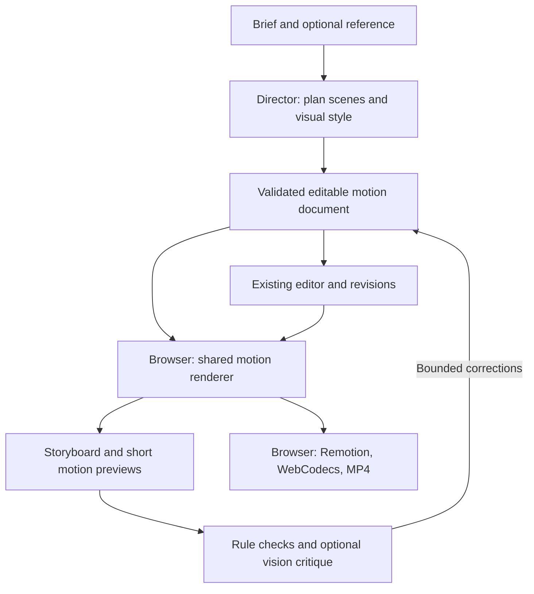

**VidsAI motion graphics: architecture and implementation plan**

Research date: 8 November 2026. Status: proposed; implementation has not started. Based on the working repository at commit `cbcf773`, the supplied reconstruction project, its source files, its rendered storyboard, and current primary documentation. No model inference benchmark was run during this analysis.

Execution update, 9 November 2026: follow `../motion-graphics-tasks.md` for the latest user-approved scope: prompt + reference input, a persistent multi-agent chat workflow with verified thinking modes, and browser rendering. That checklist uses the models already configured in `.env`; the local-model/new-provider shortlist below is background research rather than an installation requirement. Its final live reference-video acceptance criteria take precedence over this earlier phased proposal.

**1. Recommended direction**

Build an AI-assisted motion design system inside the existing VidsAI repository. The AI produces an editable scene specification; a tested animation engine draws it; the existing browser exporter makes the MP4. Reuse the application's editor, projects, revisions, audio, asset storage, and export lifecycle.

The first quality target is the kind of typography, geometry, pacing, and finishing visible in the supplied 15-second reel. That is achievable with browser drawing APIs. A promise to recreate any arbitrary reference at the same quality would require much broader capabilities and evaluation.

The main investment is a well-designed animation library and a render/inspect/revise loop. A language model alone does not supply a reliable motion design product. Free models are candidates to orchestrate that library; their aesthetic performance must be measured on actual briefs.

**2. What the other Codex session actually built**

The source project is at `C:\Users\pp\Documents\ChatGPT\undertand motion videos`. Read `VIDAI-RECONSTRUCTION-REPORT.md`, `src/reel.js`, `src/config.js`, `render.mjs`, and `trace-liquid.mjs` when implementing. The generated storyboard is `output/storyboard.png`.

| Part | Actual mechanism | Implication for VidsAI |
| --- | --- | --- |
| Creative direction | Inspect reference frames, identify scenes, author code, inspect renders, revise | We need explicit planning and visual feedback stages |
| Typography and geometric scenes | JavaScript Canvas 2D, deterministic timing, masks, easing, seeded particles | Reusable TypeScript drawing components can reproduce this class of work |
| Liquid animation | Contours traced from reference frames and played as vector keyframes; procedural alternative also exists | Traced motion is reference-derived, not a universally generated fluid simulation |
| Soundtrack | Extracted from the supplied reference | Use uploaded/licensed music or approved existing tracks; the engine did not generate music |
| Export | Chrome drew exact frames; Node/Playwright transferred PNGs; native FFmpeg encoded MP4 on the PC | Preserve the drawing logic but use VidsAI's browser encoding path |
| Validation | Storyboard inspection, browser controls, and decoding all 900 output frames | Successful decoding does not prove aesthetic similarity |

The reel combines gravity/rings, masked kinetic typography, a morphing grid, an easing diagram, a polygon tunnel/particle sphere, liquid shapes, and an identity card. The sphere is projected mathematical geometry drawn on Canvas; it does not require a 3D engine. The strong visual result also depends on font selection, spacing, deliberate transitions, contrast, grain, and audio timing.

The original output is 1920x1080 at 60 FPS for 15 seconds and about 84.35 MB. VidsAI currently exports at up to 720p/30 FPS with a 4 Mbps video setting. Matching the scene design is a separate milestone from matching that output profile. Hardware WebCodecs encoding will not reproduce FFmpeg's x264 CRF settings exactly.

Before reuse, remove the single global canvas dependency, fixed 1920x1080 layout, repeated hard-coded scene times, fixed 15-second assumptions, and text squeezing. Replace reference-specific assets with approved assets or clearly identified reference-derived material. Preserve applicable source/font/asset notices.

**3. Concrete gaps in the current app**

| Existing location | Finding | Required update |
| --- | --- | --- |
| `resources/js/editor/pages/CreateOptions.tsx` | Motion graphics is a coming-soon card | Add its own brief and creation route |
| `shared/contracts/index.ts` | `motion_graphics` is an array with `max(0)` | Introduce validated motion scene types and document migration |
| `shared/timeline.ts` | A motion item interface exists with arbitrary component props | Replace permissive props with registered, typed parameters |
| `shared/compositions/VideoMerger.tsx` | Motion items render empty sequences | Add a real motion component registry and Canvas adapter |
| `resources/js/editor/browser-export/profile.ts` | A timeline without video/image clips is rejected | Accept valid motion-only timelines and add motion workload limits |
| `shared/editing-core/index.ts` | Commands operate on existing video, text, audio, overlays | Add reversible commands for motion scenes, text, palette, and timing |
| `server/agent/planner.ts` | Text-only request, at most 12 operations, short timeouts, no visual inspection | Add a separate motion planner with structured outputs and staged jobs |
| `server/document.ts`, `server/app.ts`, database | Creation/review/thumbnail logic assumes footage scenes and narration-oriented fields | Add explicit workflow metadata, motion creation, and motion thumbnails |
| Browser export module | Already has cancellation, output checks, audio handling, and streamed output | Extend it rather than creating another server renderer |

The installed Remotion 4.0.541 web-renderer explicitly draws HTMLCanvasElement pixels. This was verified in the installed package. Its existing Canvas support is the preferred integration path. Current Remotion documentation confirms browser rendering uses WebCodecs/Mediabunny and has rendering limitations that must be checked for each component. [Client rendering](https://www.remotion.dev/docs/client-side-rendering/), [limitations](https://www.remotion.dev/docs/client-side-rendering/limitations).

The existing `generated` media type behaves like an image. Do not use it as a misleading container for live motion scenes. Likewise, don't flatten all motion into an MP4 before editing: that would lose the editable text and shapes users need.

**4. Architecture and where the work runs**



| Work | Location |
| --- | --- |
| Preview, scrubbing, drawing, rendering and MP4 encoding | User's browser |
| Sampling an uploaded reference, thumbnail generation, basic color analysis | Browser; workers where useful |
| Planning and visual critique during development | Local model on the developer PC, or an explicitly selected hosted provider |
| Optional lightweight AI editing for compatible users | Browser model in a worker |
| Accounts, persistence, provider secrets, job coordination, limits | Existing VidsAI server |

Rendering and AI inference are separate workloads. A remote model may generate a small scene specification while all frames are still rendered by the user. If our laptop serves the model, it is still our inference server; it does not become the public user's local model. A visitor's device must be capable and download a model to perform local inference.

Use `renderScene(context, scene, localFrame, fps, dimensions, assets)` as the stable drawing interface. Frame pixels should depend on the document, frame number, renderer version, seeded randomness, and fixed assets. Seeking backwards must not require replaying earlier frames. Physics-style effects should use analytic motion or precomputed bounded trajectories.

A React adapter obtains Remotion's current frame and invokes that same drawing function for preview and export. Await fonts and assets before capture; use Remotion readiness mechanisms correctly, with cancellation and cleanup. Initially draw synchronously per frame. Move expensive preparation to workers first; do not assume the entire React/DOM exporter can run in a worker. OffscreenCanvas becomes an optimization only after frame synchronization is proved.

Direct Mediabunny CanvasSource export is a later optimization if profiling shows material overhead. It supports timestamped canvas frames and backpressure. It must use the same drawing function and existing lifecycle, not become a second visual implementation. [Mediabunny media sources](https://mediabunny.dev/guide/media-sources).

**5. The editable motion document**

Keep a versioned document with integer frame intervals, workflow, renderer version, seed, layout/aspect ratio, palette, fonts, audio, and motion scenes. Each scene has a stable ID, registered type, component version, layer order, typed parameters, and cost metadata. Validate bounds before any drawing or model response is applied.

Start with high-level components built from composable text, shapes, groups, masks, transforms, and easing. The model can arrange and combine these building blocks rather than merely select one fixed whole-video template. Bound nesting, point counts, text length, particle counts, durations, and asset sizes.

Example of a proposed scene, not an existing contract:

```json
{
  "id": "headline-1",
  "type": "kineticWords",
  "componentVersion": 1,
  "start_frame": 0,
  "end_frame": 90,
  "params": {
    "words": ["MAKE", "IDEAS", "MOVE"],
    "entrance": "maskedRise",
    "layout": "centered",
    "accent": "primary",
    "framesPerWord": 30
  }
}
```

The schema and registry are authoritative; the example must eventually be compiled against them. Persist a complete immutable render snapshot. Preserve old document migrations and existing footage projects. Add explicit handling for unsupported component versions rather than silently dropping a scene.

New agent tools should include `add_motion_scene`, `update_motion_scene`, `remove_motion_scene`, `reorder_motion_scenes`, `set_motion_palette`, `set_motion_text`, and `set_motion_timing`. Asset commands refer to project-owned IDs. Extend existing revision checks and undo/redo. Model-proposed changes remain drafts until validated; targeted scene regeneration must preserve unaffected scenes.

**6. Free model shortlist and realistic usage**

These are candidates to benchmark, not a claim that any has matched the original Codex result. Availability and zero-price routes were checked on the research date.

| Role | Candidate | Recommendation |
| --- | --- | --- |
| Local development planner and reference-image interpreter | Qwen3.5-4B, quantized, through native Windows Ollama | First local baseline; short context, one job at a time |
| Hosted prototype director/vision critic | `google/gemma-4-31b-it:free` through OpenRouter | First hosted comparison; validate JSON ourselves and handle quotas |
| Optional browser text planner/editor | WebLLM `gemma-4-E2B-it-q4f16_1-MLC` | Evaluate for simple scene plans and edits after core rendering works |
| Development coding experiments | `cohere/north-mini-code:free` | Candidate for authoring library components under developer review |
| Trial-only visual reasoning experiments | `nvidia/nemotron-3.5-super-vl:free` | Do not make this the public production dependency |

Qwen's official 4B and 9B model cards list Apache 2.0. Ollama provides a 4B text/image package and supports schema-constrained local outputs. The current PC has an i7-13620H, about 13.7 GiB OS-visible RAM, and an RTX 4060 Laptop GPU with 8,188 MiB VRAM. A quantized 4B model is a sensible starting experiment; 9B leaves less graphics/context headroom. Neither fit nor performance has been tested here. [Qwen 4B](https://huggingface.co/Qwen/Qwen3.5-4B), [Ollama package](https://ollama.com/library/qwen3.5:4b), [structured outputs](https://docs.ollama.com/capabilities/structured-outputs), [Windows support](https://docs.ollama.com/windows).

OpenRouter currently lists Gemma 4 31B at zero token price with image/text support. Its endpoint supports JSON mode but not guaranteed JSON-schema enforcement; parsing, Zod validation, and bounded repair are still needed. Free routes have account/provider limits and can disappear. The planner's hard-coded `arcee-ai/trinity-large-preview:free` default was absent from the current catalog, illustrating why provider capabilities should be configurable and checked. [Gemma endpoint](https://openrouter.ai/google/gemma-4-31b-it:free), [rate limits](https://openrouter.ai/docs/api_reference/limits).

The WebLLM Gemma E2B package exists, but its model card explicitly excludes vision weights. Use it initially for text edits, not screenshot critique. Its default context is 4,096 tokens and its f16 variant requires WebGPU shader-f16. The current WebLLM registry estimates roughly 3.4 GB VRAM for that configuration; browser/model/runtime overhead still needs measurement. Load on demand, offer cancellation, cache the download, and unload before export if memory pressure requires it. [MLC model package](https://huggingface.co/mlc-ai/gemma-4-E2B-it-q4f16_1-MLC), [WebLLM](https://webllm.mlc.ai/docs/), [registry](https://github.com/mlc-ai/web-llm/blob/main/src/config.ts).

North Mini Code is a current free hosted coding candidate. Its 3B active parameters do not imply 3B total weights: it is a 30B-total MoE model. Do not plan to fit it into this laptop's GPU by counting only active parameters. [Provider model card](https://openrouter.ai/cohere/north-mini-code:free).

The Nemotron free endpoint specifically links NVIDIA's trial terms and warns against uploading confidential/personal information. Those terms restrict both the trial API and generated content from production use. Open weights and a hosted free trial have different permissions. [Endpoint disclosure](https://openrouter.ai/nvidia/nemotron-3.5-super-vl:free), [trial terms, section 1](https://assets.ngc.nvidia.com/products/api-catalog/legal/NVIDIA%20API%20Trial%20Terms%20of%20Service.pdf).

Keep one provider interface for local and hosted planning, with per-role model selection, image support, JSON support, quota status, deadlines, and cancellation. Use an allowlist of zero-price routes for free mode and never silently fall back to a paid route. Redact secrets from logs. Send reference frames to a hosted provider only through an explicit upload/data-use choice. Benchmark a small number of models on our own briefs before choosing the default.

**7. Reproducing the creative process**

The director first converts the brief into a compact creative plan: message, duration, scene sequence, visual family, typography hierarchy, palette, motion vocabulary, and audio cues. It retrieves a few matching examples and component descriptions rather than the entire component source. A compiler maps that plan into the strict document and resolves layout constraints.

The browser renders representative frames and short scene previews. Deterministic checks find missing assets, timing errors, text overflow, unsafe density, and unsupported effects. A vision-capable model can critique readability, hierarchy, scene consistency, and reference alignment. A contact sheet alone cannot establish good motion: include beginning/middle/end samples and short playback previews for pacing and transitions.

Allow an initial plan and at most two repair iterations, under a total token/time/request budget. This is one staged workflow; it does not require many concurrently running agents. Each repair is a validated patch against the original revision. If the budget is exhausted, return the best valid draft with editable controls and a clear result instead of looping indefinitely.

Retain multiple curated design recipes: kinetic editorial, geometric brand intro, clean explainer, product announcement. Recipes encode good spacing, pacing, type scales, palette roles, safe areas, and transition combinations. Users can change text, timing, colors, and composition. This gives small models a useful design vocabulary and reduces generic-looking results.

For entirely new effects beyond the registry, a later developer workflow can generate a component in an isolated environment, inspect it, test it, and promote a reviewed version into the library. Arbitrary generated JavaScript should not execute with the main application's privileges. A normal worker alone is not a security boundary. Public custom-code support would be a separate sandboxed feature with a narrow API and resource controls.

**8. What users will see**

| Screen | Motion workflow behavior |
| --- | --- |
| Create | Brief, short duration, aspect ratio, visual direction, optional logo, reference and music; narration optional |
| Waiting | Real stages: interpreting brief, arranging scenes, drawing previews, checking the result |
| Review | Animated scene cards, editable copy and durations, reorder, regenerate one scene |
| Style | Typography, palette, motion intensity, transitions, music suggestions; captions only where relevant |
| Editor | Existing preview/timeline plus motion scene/layer selection and contextual text/color/timing controls |
| Export | Existing local export flow with validated motion complexity and device-appropriate quality |
| Dashboard | Motion project badge and actual rendered cover thumbnail |

The interface retains the current orange/charcoal direction. Motion scene content can use the user's chosen palette. Artwork generation is optional; most of the demonstrated reel needs no generated bitmap images or video model. Uploaded logos and approved vector assets are more predictable starting inputs.

**9. Browser limits and quality strategy**

Start the motion MVP at 5-15 seconds and 720p/30 FPS. Proposed initial limits are eight scenes, one active scene plus one during a transition, up to 24 explicit layers per active scene, and a bounded total particle/geometry workload. These are proposed conservative gates, not measured universal crash-prevention guarantees. Add separate complexity accounting for particle systems and path geometry because one layer can contain thousands of draws.

Use 360p/540p previews, render thumbnails only when needed, run one export at a time, await encoder backpressure, stream to existing local output storage, and dispose frames/canvases/decoder resources. Cache immutable fonts and geometry. Enforce output-storage checks, cancellation, GPU-loss handling, and a recoverable lower-quality option. Never retain the whole raw video in memory: 900 RGBA frames at 1080p would consume about 7.5 GB before other work.

Keep browser LLM inference and export mutually exclusive on constrained devices. Capability probes and representative render benchmarks are better than guessing based on a browser's reported RAM. Test a weaker integrated-GPU machine as well as this laptop. Chrome/Edge desktop is the initial supported export target; expand browser/phone support only after actual export testing.

Then qualify a separate motion-only 1080p/30 profile and a short 1080p/60 profile for capable devices. 1080p/60 processes 4.5 times as many output pixels per second as 720p/30. It does not necessarily require real-time drawing: frames may take longer to compute while retaining correct output timing. Compare text edges, gradients, moving grain, music sync, encode time, and file size before setting bitrate presets. Do not globally loosen the current footage-decoder limits when adding procedural export profiles.

**10. Implementation order and grouped verification**

| Group | Executable work | Verification before committing |
| --- | --- | --- |
| 1. Rendering proof | Extract drawing math into `shared/motion`; implement typed headline, impact/rings, and identity-card scenes; add a frame-driven Canvas adapter; run a development fixture using the installed browser renderer and existing codec/output utilities before changing production document contracts | Typecheck/build plus one short browser MP4; compare selected preview/export frames, exact duration, and cancellation |
| 2. Motion document | Version schema and migration; replace the empty motion-track restriction; connect the adapter to VideoMerger and normal export; implement registry/commands; accept motion-only timelines; persist renderer version, seeds, fonts and asset references | Grouped contract/editing tests for load/save, rejected invalid plans, undo/redo, revisions, deterministic seeking; open one old footage project |
| 3. Visual quality library | Add grid, easing diagram, tunnel, particle sphere, procedural liquid and vector-keyframe scene; centralize timing; add typography fitting, safe areas, aspect-ratio layouts, finishing presets | Render the seven-scene benchmark at the supported profile; inspect storyboard and playback together; exercise long text, Arabic/RTL, portrait and square |
| 4. Product workflow | Add motion create route and workflow metadata; connect processing/review/style/editor/dashboard; add scene controls, thumbnails, optional music and audio timing | One full manual browser flow: create, edit, save, reload, undo, export; grouped regression of existing video creation/editor/export |
| 5. AI director | Add local and hosted provider adapters, model capabilities, example retrieval, strict plan compiler, staged jobs, preview critique and at most two repairs | Benchmark 20 representative briefs; log validity, latency, repairs, visual scores and quota failures; no invalid proposal may be applied |
| 6. Reference-assisted creation | Decode bounded local samples, detect candidate cuts, estimate palette, create timestamped contact sheets; use vision to describe supported scenes; preserve source provenance | Five varied references; distinguish supported recreation from approximation; confirm exact typography can be edited; review motion clips, not only stills |
| 7. Release quality and high-quality export | Tune workload limits; qualify 1080p profiles; fix audio sync and recovery; add provider quota UX and operational metrics | Device matrix, repeated export/cancel/reload, complete decode and selected frame inspection; ordinary workflow regression once for the release |
| 8. Optional local AI and advanced effects | Benchmark browser Gemma text editing; add cached opt-in model download; profile optional Pixi acceleration; extend design recipes | Verify download/cancel/fallback, GPU cleanup before export, no mandatory model download to use editor; compare visual quality and resource use before shipping |

Groups 1-4 produce a usable manually editable motion workflow. Group 5 produces prompt-to-motion creation. Group 6 adds reference guidance. Group 7 establishes the public MVP release gate; higher profiles remain capability gated. Group 8 is optional expansion, not a reason to delay the core product. Follow the existing commit/push cadence after meaningful grouped checks during implementation.

Suggested release acceptance targets: at least 18 of 20 supported briefs produce a valid draft within the repair budget; no unvalidated plan is applied; no repeatable clipping/missing-font defect in the benchmark; sound is aligned within one output frame on the reference fixture; export completes and cancellation releases resources on every supported test device. These are proposed criteria, not achieved results. Human review must separately score hierarchy, typography, pacing, consistency, and brief adherence. Passing schema tests alone is insufficient.

**11. Tools and environment**

| Tool | Decision |
| --- | --- |
| React/TypeScript, existing Remotion Player and web-renderer | Keep and extend |
| Canvas 2D, Path2D, deterministic easing/seed helpers | Main motion engine; native browser APIs |
| Existing Mediabunny/WebCodecs and local output storage | Keep for browser MP4 and bounded media handling |
| Zod and existing revision commands | Typed scene contracts and reliable edits |
| Existing Node 24/Express/SQLite | Persist projects and coordinate AI jobs; no second rendering service |
| Native Windows Ollama | Optional development inference environment; no Mac needed |
| WebLLM/WebGPU | Optional later browser text inference, isolated from export resource use |
| Playwright | Development integration/visual verification, not a customer installation requirement |
| FFmpeg, sharp, Python tracing tools | Optional development/reference fixtures and output inspection, not mandatory browser runtime dependencies |
| PixiJS | Add only if dense effects need acceleration; current docs recommend WebGL for production and label WebGPU experimental |

Pixi supports both WebGL and WebGPU, but adopting it immediately would add complexity before Canvas limits are measured. [Pixi renderer guidance](https://pixijs.com/8.x/guides/components/renderers). A separate 3D engine, After Effects, a video diffusion model, a new agent framework, or a second repository is not required for the supplied example. Advanced tracing, 3D, Lottie/Rive imports, and GPU shaders can follow demonstrated demand.

Remotion currently offers its free license to individuals and companies of up to three people. Given the stated solo organization, retain the existing eligible configuration and revisit if the organization changes. [Remotion license/pricing](https://www.remotion.dev/docs/license/pricing).

**12. Cost model and first deliverable**

Browser rendering removes our per-minute cloud video-render bill. Deterministic preset creation, manual editing and local exports can work without model inference. Hosted AI planning, storage, bandwidth, model distribution, and support still have costs or quotas. Open weights remove a model license fee, not electricity/hardware costs. A free endpoint is a limited service, not guaranteed production capacity.

For the public product, keep free editing and browser export available independently of inference. Offer capped hosted generations or user-supplied model access, plus optional device-local AI where supported. The developer laptop is suitable for experimentation and a limited demo, not a high-availability public inference service. No automatic paid fallback belongs in a free-only mode.

The first implementation deliverable should be a short, polished, editable three-scene motion video inside VidsAI that exports through the existing browser pipeline. Establish that foundation, expand it to the supplied seven-scene design vocabulary, and then benchmark free models as directors. This order isolates visual-engine quality from model quality and makes each subsequent improvement measurable.
