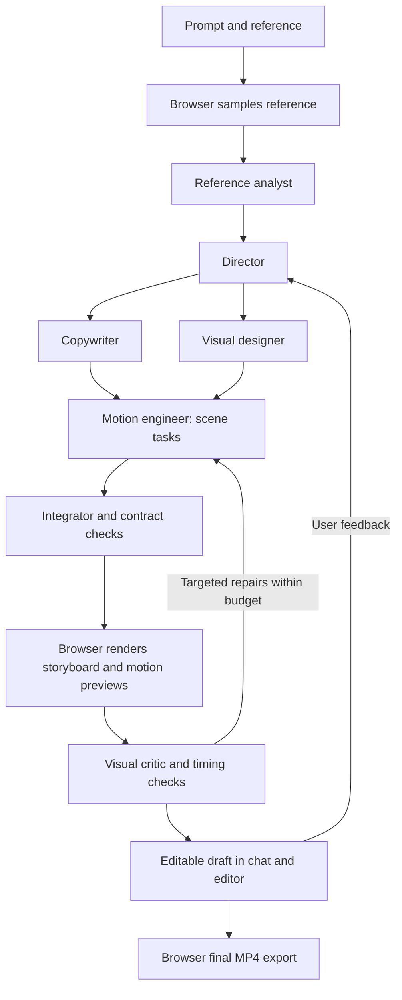

**VidsAI motion graphics — executable task checklist**

Created 9 November 2026. Status: planned; all implementation tasks below are unchecked. Execute in order in `D:/VidsAI-migration/full-typescript/vidsAi`.

This is the execution contract for the user's latest request: Create → Motion graphics → prompt + reference → a persistent chat workspace running a substantial multi-agent, multi-step workflow with supported thinking modes → an editable motion video → browser-rendered MP4. It takes precedence over model choices and optional scope in `docs/MOTION_GRAPHICS_PLAN.md`. Use the models already configured in `.env`. Installing new local models or introducing another model provider is not a prerequisite.

The existing `task.md` remains the record of the completed browser-rendering migration. Preserve existing projects, the working Video from scratch workflow, and all unrelated user edits. Keep the current orange/charcoal UI. Work in this repository; the former Remotion API repository is not a dependency.

**Completion contract**

- The Motion graphics card is functional. The creation form explicitly requests a prompt and reference video/image. Reference-guided mode requires a valid reference; an explicit prompt-only mode may also be offered.
- Submitting creates a real saved project and opens a chat workspace. The app performs reference analysis, direction, copy/design planning, scene construction, rendering, critique, and targeted repair through distinct specialist agents and typed tools.
- Thinking is actually enabled on appropriate, verified model routes. The chat shows concise decisions, work summaries, tool progress, previews and revision results. It does not fabricate activity or expose raw hidden reasoning as the product's progress feed.
- Jobs survive refresh and backend restarts. Browser-dependent tasks honestly wait for an active browser; they never secretly switch to server rendering. Users can stop, retry, resume and refine the project through chat.
- The final project contains editable motion scenes, text, colors, timings and audio. The user can review scenes, adjust them manually, undo changes, reopen the project and export it.
- All preview composition, motion drawing, frame rendering, audio mixing for export, encoding and MP4 assembly run in the user's browser. Configured AI inference, project persistence and coordination may remain server-side.
- Every required dependency, font, application skill, prompt, tool implementation and runtime configuration is installed or bundled and verified on a clean setup. No hidden dependency on this Codex session or its private runtime paths remains.
- The final live acceptance run creates a fresh 15-second video in the visual family of the supplied reel from a prompt and reference. All seven demonstrated scene families are represented. It is not a prerecorded MP4, canned successful chat log, or imported completed document.
- The reference laptop must pass a 1920x1080/60 FPS browser export for that short benchmark, in addition to the conservative 720p/30 profile. Do not silently reduce that target and call reference-quality delivery complete. Other devices receive only profiles they pass.
- Automatic checks establish integrity and deterministic behavior; side-by-side visual review establishes typography, composition, motion and pacing quality. Both are required. Any unverified or failed acceptance item remains open.

**Evidence and current starting point**

Working baseline: `cbcf773` on `codex/browser-rendering`, with existing uncommitted UI/artwork work. Recheck before implementation.

Reference project: `C:/Users/pp/Documents/ChatGPT/undertand motion videos`. Inspect `VIDAI-RECONSTRUCTION-REPORT.md`, `src/reel.js`, `src/config.js`, `render.mjs`, `trace-liquid.mjs`, `output/storyboard.png`, and `output/rebuilt-pink-orange-cream.mp4`. Its liquid vectors and soundtrack are reference-derived. Keep private/reference media outside Git and preserve bundled font licenses.

The existing app has React 19, TypeScript, Zod, Node 24+, Express, SQLite, Remotion 4.0.541, Mediabunny 1.64.0 and Playwright. `shared/contracts/index.ts` rejects nonempty `motion_graphics`; `VideoMerger.tsx` renders their reserved slot as null; the export profile rejects timelines without footage. `server/agent/planner.ts` has short request deadlines and disables Nemotron thinking. These are implementation gaps, not reasons to replace the whole application.

Read `nvidia/LIVE_VALIDATION.md`, `nvidia/models.json`, and `nvidia/requests.json` with care: the November 2 checks validated existing short editing/writing requests, mostly with thinking disabled. A red-square image test did not validate video comprehension, the new workflow, reasoning mode, or all stored model IDs. Some stored candidates timed out or returned 404. Treat configuration, historical success and current verified capability as separate states.

**Configured model routing to implement**

Resolve real model IDs, credentials and endpoints server-side from the current environment. Never print key values, copy them into this checklist, bundle them into the frontend, or send them to model prompts. The following are current route names, not a license to try every stored model on every request.

| Agent or function | Initial route from `.env` | Routing rule |
| --- | --- | --- |
| Reference analyst | `NVIDIA_ROUTE_MEDIA_UNDERSTANDING_*`: Nano Omni → Super VL → Mistral Large 4 | Only image/video-capable adapters that pass the new reference test |
| Director and difficult planning | `NVIDIA_ROUTE_AGENT_COMPLEX_*`: Super VL → Ultra | Enable verified reasoning settings; Ultra is only a text-stage fallback unless vision is independently established |
| Copywriter | `NVIDIA_ROUTE_WRITING_*`: Super VL → Lightning | Use concise structured outputs; do not promote Lightning to complex editing based on writing success |
| Visual designer | Super VL; validated candidates from the configured agent/media inventory | Receives direction, approved reference observations, layout rules and component capabilities |
| Motion engineer | Super VL → Ultra for text specifications; configured DeepSeek/Mistral/Gemma candidates only after targeted qualification | Builds editable scene graphs using the tool registry; no arbitrary package installation or privileged code execution |
| Visual critic | Verified Super VL or Nano Omni route; verified Mistral fallback | Must receive actual rendered frame/preview artifacts, not only the planner's description |
| Integrator and final checks | Deterministic compiler/validators; complex route only for semantic repair | One authoritative document writer; no conflicting parallel commits |
| Optional design-example retrieval | Existing embedding route, then existing rerank route | Add only if it improves retrieval; indexes are model/version-specific |

Relevant configured IDs include `nvidia/nemotron-3.5-super-vl-120b-a12b`, `nvidia/nemotron-3-ultra-550b-a55b`, `nvidia/nemotron-3-nano-omni-30b-a3b-reasoning`, `nvidia/nemotron-3.5-lightning-30b-a3b`, `mistralai/mistral-large-4-1t-a52b`, `deepseek-ai/deepseek-v4.1-flash`, and `google/gemma-4-31b-it`. Read their environment variables rather than hard-coding replacement IDs. Stored Cosmos, Magpie, pose and speech endpoints are not required for procedural graphics and do not become available merely because a key exists.

These configured hosted routes establish a development MVP. NVIDIA's trial service has production restrictions; record route terms/eligibility and keep public deployment as a separate release decision. This does not block developing and evaluating the requested workflow with the configured models. [Trial terms](https://assets.ngc.nvidia.com/products/api-catalog/legal/NVIDIA%20API%20Trial%20Terms%20of%20Service.pdf).

**Application agents, tools, skills and prompts**

Use the existing TypeScript server and durable SQLite job infrastructure for a purpose-built orchestrator. Multiple agents mean separate roles, prompts, inputs, outputs and independently traceable steps. Several roles may use the same configured model. Run independent scene preparation concurrently within a small shared limit; keep dependent steps sequential.

Proposed application skills live under `server/motion/skills/<name>/SKILL.md`, accompanied by a versioned manifest. These are app runtime resources; they must be loaded by VidsAI, not merely installed into Codex. Required skills: `reference-analysis`, `motion-direction`, `kinetic-typography`, `geometry-and-particles`, `liquid-and-vector-tracing`, `responsive-layout`, `audio-and-pacing`, `browser-rendering`, and `visual-critique`.

Each skill must contain scope, required observations, supported component IDs, design rules, input/output schemas, allowed tools, at least two concrete examples, common failure/repair cases and a capability/version requirement. Prompts live under `server/motion/prompts/` with `director.md`, `reference-analyst.md`, `copywriter.md`, `visual-designer.md`, `motion-engineer.md`, `visual-critic.md`, and `repair.md`.

Each prompt must identify its role, the user's brief, the current revision, attached observations, selected skills, tool schemas, output schema, resource budgets, and how uncertainty is represented. Require readable copy, explicit timing, asset IDs, supported scene types and a concise decision summary. User references, OCR text and uploaded files are data rather than instructions to change tool permissions. Do not request a raw chain-of-thought transcript. Persist prompt/skill versions with the run so failures can be reproduced.

| Tool contract to implement | Execution location and result |
| --- | --- |
| `inspect_reference`, `sample_reference_frames`, `detect_reference_cuts`, `extract_palette` | Browser; bounded metadata, timestamped images and confidence-bearing observations |
| `trace_reference_shapes` | Browser worker; bounded editable vector keyframes with source timestamps |
| `list_motion_components`, `get_motion_component_schema`, `search_design_examples` | Server/shared registry; only shipped versioned capabilities |
| `propose_motion_plan`, `validate_motion_document`, `measure_text_layout` | Shared/compiler and browser font measurement; typed validation issues |
| `build_motion_scene`, `patch_motion_scene`, `set_motion_style`, `set_motion_timing` | Validated draft operations; no direct database writes from an agent |
| `render_storyboard`, `render_scene_preview`, `compare_motion_frames` | Browser; actual images/clips, frame numbers, hashes and diagnostic metrics |
| `inspect_audio`, `suggest_music`, `set_music_cues` | Browser analysis plus existing music provider; project-owned audio references |
| `commit_motion_revision`, `restore_motion_revision` | Server revision service with ownership, idempotency and expected revision |
| `export_motion_mp4` | Browser through the existing export lifecycle; final file and verification metadata |

Every tool needs a Zod input/output schema, allowed-role list, timeout/cancellation behavior, resource cost, artifact ownership rules and implementation. Do not advertise unimplemented tools or let the model invent URLs, component names or success receipts.

**Verification and implementation rules**

Check a task only when its deliverable exists. Work through groups A–J; run the four grouped checkpoints below rather than a full export suite after each checkbox. Use small reproductions/type checks while coding. After a checkpoint passes, record commands, revision, device/browser versions, artifact locations and limitations, then commit and push that checkpoint's implementation to the working branch under the user's standing instruction. Preserve unrelated changes; stage only the milestone's files. A failed check stays open and is rerun after a relevant fix.

Keep runtime artifacts under `../runtime/motion-verification/`, separate from source and secrets. Use mocked providers for routine regression and clearly label mocks. Reserve real configured-provider calls for targeted capability qualification and the final live workflow. Never silently use a paid/new provider or disable required thinking to manufacture a pass.

Proposed scripts below do not exist yet. Implement them at the specified tasks before treating their names as verification evidence. Existing `npm run typecheck`, `npm run build`, `npm test`, and `npm run test:browser` remain available; inspect their fixture requirements before reuse.

**Group A — install and qualify the environment**

- [x] A1. Capture the current Git status, package versions, running services and working footage flow. Record a source manifest for the supplied reel, its scene boundaries, assets and licenses. Preserve the user's modified artwork and landing-page files. Deliver `docs/MOTION_BASELINE.md` plus private baseline artifacts.
- [x] A2. Add repeatable Windows setup and diagnosis scripts (`motion:setup`, `motion:doctor`). Resolve Node 24+ and npm without hard-coded Codex paths, install the locked app dependencies on a fresh setup, and verify Chrome/Edge, WebCodecs, Canvas, fonts and local-output capability. Check port/configuration conflicts without stopping unrelated services.
- [x] A3. Add a versioned toolchain manifest. Reuse installed React/Remotion/Mediabunny/Zod/Playwright; bundle the required font files and notices. Install a pinned development FFmpeg binary for independent output inspection and any necessary image-diff utility. Port browser reference operations to TypeScript so Python/sharp/native FFmpeg are not customer or production-render requirements. Keep native tools out of frontend bundles and Git binaries.
- [x] A4. Build a sanitized `.env` inventory reader and model capability registry. Distinguish configured, reachable, qualified, unsupported and temporarily unavailable routes. Retain per-model credentials and API-family distinctions. Report presence/status only; reconcile older inventory metadata with actual current tests.
- [x] A5. Add model-specific adapters for text, images, streaming, final JSON and reasoning options. Verify the actual hosted contract before using `enable_thinking` or reasoning budgets. Enable supported thinking for the director, reference analysis, motion engineer and critic; allow concise non-reasoning copy formatting. Preserve the existing fast footage/editor routes.
- [x] A6. Implement `motion:check-models` with an offline default and explicit live mode. In one bounded live qualification batch, test a tiny planning task, image observations, thinking-enabled structured final output, streaming/cancel and one compatible fallback. Record requested/effective mode, final-output parsing, latency, token use and failures. Historical thinking-off successes do not satisfy this task. Do not sweep all 21 models unnecessarily.
- [x] A7. Add configurable run/provider budgets, role routes and request deadlines. Start with at most two concurrent provider requests, one browser render task, three critique rounds, 40 total model attempts including retries, and an operator-configurable active-work deadline (initially 20 minutes). Use model-appropriate token budgets and reserve output capacity beyond reasoning. Count usage across every agent/fallback. Bound waiting-for-browser separately and measure before changing limits.

Done when: setup and doctor work on a clean checkout, shipped assets resolve, required role routes are qualified or report a concrete blocker, and no installed dependency is implicitly sourced from another Codex project.

**Group B — editable scene contracts and tools**

- [x] B1. Introduce a backward-compatible document migration and explicit `workflow: motion_graphics` metadata. Add project creation/storage for motion without fake voiceover or stock-scene rows; preserve the existing product/service fields and old documents. Define one authoritative duration and frame-based timeline.
- [x] B2. Replace `motion_graphics.max(0)` and arbitrary component props with a discriminated, versioned scene schema. Include IDs, start/end frames, layer order, component version, seed, layout, palette/font references and typed parameters. Add strict validation for intervals, finite values, text, geometry, nesting, assets and total complexity.
- [x] B3. Build `shared/motion/registry.ts` and a shared component interface. Every entry exposes parameter schema, defaults, layout support, editable fields, cost estimates and renderer version. Unknown or mismatched types produce actionable errors rather than empty output.
- [x] B4. Implement a plan-to-document compiler and a bounded compositional scene graph: text, paths, shapes, groups, masks, transforms and parameterized motion curves. Prefer expressive combinations of these primitives. If expressions are needed, use a typed allowlisted expression tree, not arbitrary JavaScript evaluation.
- [x] B5. Extend `shared/editing-core` with add/update/remove/reorder motion scenes, palette/text/timing changes and revision restoration. Route both agent tools and manual controls through these operations. Detect simultaneous edits and stale proposals; preserve undo/redo and unaffected scene IDs.
- [x] B6. Add motion font/image/vector/audio dependencies to asset resolution, ownership checks, hashing, caching and recovery. Store durable IDs rather than blob URLs. Distinguish generated geometry, reference-derived vectors and imported media in provenance metadata.
- [x] B7. Implement the tool registry and draft/revision boundary described above. Add permission checks, typed results, explicit artifact handles and single-writer commits. Ensure agent-created scene batches are validated before entering the canonical project.

Done when: a valid motion-only document can be stored, reopened, edited and rolled back; invalid agent output cannot enter a project; old footage documents still load.

**Group C — reproduce the demonstrated visual engine**

- [x] C1. Extract the reusable drawing/math from the supplied reel into `shared/motion`. Remove global DOM state, absolute filesystem assumptions and duplicated fixed durations. Implement deterministic random-access frames with seeded randomness, reset drawing state and explicit asset readiness.
- [x] C2. Implement impact/bounce, expanding rings, masked headlines and kinetic words with editable copy. Add proper text measurement, wrapping, fitting, type hierarchy, line breaks, alignment and whole-word masks. Support Arabic/RTL and avoid stretching arbitrary text to a fixed width.
- [x] C3. Implement the rotating/morphing grid, easing diagram with trails, polygon tunnel and projected particle sphere. Expose meaningful artistic parameters and quality-dependent particle counts while preserving frame determinism.
- [x] C4. Implement both procedural liquid and vector-keyframe playback. Permit palette changes and retiming; keep traced and procedural modes distinct. Validate imported path data and interpolate only compatible path topology; otherwise use explicit sampled-keyframe playback.
- [x] C5. Implement the identity card, scene transitions, optional framing details, gradients, vignette and deterministic grain. Add coherent visual recipes including the supplied pink/orange/cream family and VidsAI's orange/charcoal family. Build real portrait/square layouts, not a stretched landscape canvas.
- [x] C6. Add the Remotion Canvas adapter driven by `useCurrentFrame`; integrate it into `VideoMerger` for both preview and browser export. Await actual fonts/assets/paint completion and clean up every readiness handle on error/cancel. Preserve existing caption, overlay and audio order.
- [x] C7. Extend browser preflight to accept valid motion-only timelines. Introduce separate procedural workload limits without weakening footage decoder limits. Reuse output streaming, codec probes, progress, cancellation, recovery and preview suspension; keep the server export route disabled.
- [x] C8. Create a deterministic development benchmark covering all seven scene families and reference frame times. Add `motion:test --suite foundation` and `motion:verify-render` using private output paths. The benchmark validates the engine; it must not become a hard-coded response to a user's prompt.

**Checkpoint 1 — foundation (A–C)**

- [x] V1. Run doctor, typecheck/build, focused document/operation tests, font/layout/seek checks and one small browser export with audio. Decode the actual output and compare representative preview/export frames. Verify cancel/cleanup and an existing footage fixture. Record the model qualification separately. Commit/push only after these checks pass; defer the long reference export and broad device matrix to the final checkpoint.

Checkpoint evidence is recorded in `docs/MOTION_BASELINE.md` and `docs/MOTION_SETUP.md`.

**Group D — reference ingestion and browser analysis**

- [x] D1. Implement reference file selection, metadata preview and bounded validation. Start with one video up to 30 seconds/100 MiB/1080p or a supported image within current image limits, and allow explicit interval selection for analysis. Report unsupported codecs honestly. An image can guide style but cannot establish unseen motion.
- [x] D2. Decode and sample locally with existing Mediabunny/browser APIs. Use sparse timestamped samples first, denser sampling near candidate cuts, and a bounded high-resolution crop path for typography. Produce small contact sheets with timestamps; dispose frames immediately and support cancellation.
- [x] D3. Implement candidate scene-change detection, palette estimation and text/layout observations. Send only the selected bounded artifacts through the verified model adapter. Store observations, confidence and source timestamps; request another sample when evidence is insufficient rather than inventing details.
- [x] D4. Add reference-analysis contracts describing each scene's text, shapes, positions, movement landmarks, easing, transition, palette and estimated duration. Normalize dimensions and distinguish measured values from model estimates. Map unsupported effects to explicit approximation options.
- [x] D5. Implement configurable flat-shape tracing in a browser worker using the supplied method as a starting point: masks, contour extraction, simplification and keyframes. Select the source interval and colors from this reference's observations. Bound sampling resolution/path counts and retain provenance; do not reuse fixed thresholds as a universal segmenter.
- [x] D6. Add audio selection and bounded local timing analysis. Use uploaded audio or a selectable existing music result, with its usage metadata. Mark beats/cues and align animation accents; allow manual cue correction. Reusing reference audio is an explicit user choice with appropriate rights, not an automatic side effect of reference upload. A music-preview URL is not automatically a licensed export asset.
- [x] D7. Persist the analysis manifest and recoverable reference asset mapping. Handle refresh, relink, upload failure and account isolation. If URL import is included, fetch only validated public media with size/time/address restrictions; never allow agents to fetch arbitrary private endpoints. File upload must work independently of URL import.

Done when: a newly uploaded reference produces useful timed observations and optional derived paths entirely through product tools; no manually prepared contact sheet is required.

**Group E — ship the agent skills and prompt pack**

- [x] E1. Create the nine application skill packages listed above. Include concrete examples from the supplied design vocabulary plus different layouts/briefs. Bundle only authorized assets; make all component examples match the current registry and contracts.
- [x] E2. Create the seven versioned role prompts and a common prompt builder. Retrieve only the relevant skill excerpts and component schemas for each stage, keep user goals stable, and record versions/hashes. Exclude secrets, raw unrelated documents and unlimited conversation histories.
- [x] E3. Implement Reference Analyst and Director agents with distinct typed outputs. The analyst supplies evidence; the director produces a creative brief, storyboard, timing map and quality goals. Long reasoning settings use the qualified per-model adapter, not the current planner's global thinking-off flag.
- [x] E4. Implement Copywriter and Visual Designer agents. They may run concurrently after direction is settled. The copywriter preserves requested wording/language; the designer chooses typography, safe areas, palette roles and compatible motion patterns. Both return artifacts rather than directly modifying the project.
- [x] E5. Implement Motion Engineer tasks per scene and an Integrator. Engineers produce typed scene specifications/patches using shipped components and primitives. Integrate stable IDs and timing centrally. When an effect exceeds supported capabilities, report it and propose an explicit approximation instead of emitting an invisible stub.
- [x] E6. Implement Visual Critic and repair prompts. Assess actual rendered artifacts for text/readability, hierarchy, palette, motion landmarks, pacing, transitions and reference similarity. Return prioritized issues tied to scene IDs/frame ranges and small repairs. Treat a model score as advice, not proof of visual correctness.
- [x] E7. Add a build-time skill/prompt/tool availability check and `motion:test --suite prompts`. Validate manifests, referenced schemas, sample outputs, budgets and allowed roles; include malformed output and prompt-injection fixture cases. Loading skills must work from the packaged production server without local developer paths.

Done when: each specialist performs a distinct documented task, produces a validated artifact, and has all required skills/tools available at runtime.

**Group F — persistent multi-agent workflow with browser tools**

- [x] F1. Implement the durable orchestrator in `server/motion`. Add migrations for runs, steps, artifacts, chat messages, tool requests and ordered run events, reusing existing tables where suitable. Store project owner, starting revision, dependencies, budget usage, leases and terminal status.
- [x] F2. Implement the dependency graph above. Separate planning, analysis, independent specialist tasks, integration, browser preview, critique and targeted repair. Use bounded parallelism and a single document writer; don't simulate multiple agents with UI labels over one unstructured completion.
- [x] F3. Make the request asynchronous: create/return a run ID promptly, then stream persisted events through authenticated SSE with cursor replay and polling fallback. Persist durable summaries and artifacts; stream transient progress safely. Provide per-stage elapsed work and actual progress counts, not fabricated percentages.
- [x] F4. Implement a browser tool runner that claims project-owned jobs with a lease, executes sampling/layout/render tools locally, and returns typed results with artifact hashes. Validate ownership, expected revision and task identity server-side. Keep uploads bounded and clean up abandoned artifacts.
- [x] F5. Implement reload/reconnect recovery, browser-task heartbeats, lease expiry and cross-tab arbitration. A run enters `waiting_for_browser` when sampling/preview is needed and the tab is absent. Resume only unfinished steps; do not claim that client rendering continues after the browser closes.
- [x] F6. Implement cancellation and user steering. Cancel requests/decoders/workers, reject late step results, retain completed useful artifacts and save a recoverable draft. New feedback during work is acknowledged and applied at a safe checkpoint; do not overwrite a concurrent manual edit. Distinguish stop, retry and new revision.
- [x] F7. Implement provider failures and budget accounting across the entire graph. Honor rate limits, backoff, distinct request/first-token deadlines, exhausted reasoning without final output and compatible fallback rules. Reserve usage atomically per account/provider; a stage retry is idempotent and cannot bypass daily limits.
- [x] F8. Implement the render/inspect/repair loop with up to three total critique rounds and a global budget. Cache unchanged scenes. Deterministic failures route directly to repair; visual feedback uses real preview frames and short movement probes. Stop at a valid result, an explicit unresolved issue, cancellation, or exhausted budget.
- [x] F9. Parse and separate final answers from provider reasoning formats, including streamed tags/chunks. Display brief decisions, evidence and tool results in chat; do not persist raw hidden reasoning by default. Add redacted diagnostics containing effective model/settings, timings, usage and step failures. Partial reasoning must never be interpreted as a valid scene document.

**Checkpoint 2 — orchestration (D–F)**

- [x] V2. Run targeted analysis/skill/orchestrator tests and a small browser-tool harness with mocked models. Exercise malformed JSON, unsupported image/thinking settings, rate limit, lost browser, reconnect, duplicate results, backend restart, cancellation, stale revision and budget exhaustion. Verify real agent handoffs and actual browser preview artifacts. A full long MP4 export is unnecessary here. Commit/push after the checkpoint passes.

**Group G — Create and the motion chat workspace**

- [ ] G1. Activate the Motion graphics card and `/create/motion-graphics` route. Add a centered form with prompt, reference picker/preview, aspect ratio, duration, optional logo/music and a visible Deep creation mode. Required reference validation follows the selected creation mode. Preserve the other workflow cards and the existing scratch route.
- [ ] G2. Create the saved project and run atomically with an idempotent request key. Open its chat workspace immediately. Display attachment upload progress/errors and clarify that configured AI analyzes references while final rendering happens on the device. Do not force narration/transcription before motion creation.
- [ ] G3. Build a persistent chat conversation with multiline input, attachment chips, submission/cancel controls and history. Adapt shared assistant components where useful without coupling motion generation to the existing 12-operation editor prompt.
- [ ] G4. Display the live workflow: current specialist, stage, completed steps, concise decisions, warnings and real previews. Show Thinking only when the role is actually using a qualified reasoning configuration. Show unavailable/degraded modes honestly; provide progress while requests take minutes.
- [ ] G5. Add expandable storyboard/scene cards in the chat, with durations, copy, palette and preview playback. Allow feedback such as 'make scene 2 slower', 'use orange and cream', or 'keep the movement, change the words'. Focused revisions must preserve other scenes.
- [ ] G6. Add stop, retry failed stage, resume and open-in-editor actions. Show a usable partial draft if a later agent fails, and retain error context for retry. Surface waiting-for-browser and expired-session states without losing project history.
- [ ] G7. Add motion-specific Review and Style views using the existing shell/design system: editable scene text/order/timing, typography, palette, motion intensity, transitions and suggested music. Show captions when relevant; don't require an irrelevant subtitle step for a silent kinetic reel.
- [ ] G8. Finish desktop/compact layouts, focus handling, keyboard submission, accessible status announcements, scroll behavior and browser navigation. Refresh/back/forward must reopen the correct project/run without restarting provider jobs.

Done when: the complete prompt/reference → specialist workflow → editable draft journey is usable through the normal app navigation.

**Group H — editor, project persistence and export integration**

- [ ] H1. Show motion scenes in the timeline with real thumbnails, frame spans and selection. Add contextual controls for copy, font, palette, timing, motion parameters and scene order, backed by the shared commands.
- [ ] H2. Connect chat revisions and manual edits through expected revisions and undo/redo. Provide a before/after preview for replacing an existing scene; initial draft creation may proceed automatically. Preserve unaffected layers/audio when applying a targeted repair.
- [ ] H3. Ensure saved projects contain the canonical document, skill/renderer versions, reference provenance, chat/run links and durable asset mapping. Reopen after server/browser restart, account changes and cleared local caches; request relinking where needed.
- [ ] H4. Generate dashboard thumbnails from the real motion document and add workflow/status badges. Motion projects must open the correct workspace/editor rather than stock-footage review. Preserve current project listing/search behavior.
- [ ] H5. Integrate motion export into the existing Export control, progress, cancellation, retry, artifact storage and download. Export an immutable chosen revision; editing during export cannot alter that snapshot. Resolve fonts/audio/assets before starting.
- [ ] H6. Exercise motion-only and mixed media compositions, audio cues/fades, transitions, captions and overlays. Keep layer ordering consistent between preview/export. Optional narration must use current verified services and must not become a mandatory new model dependency.
- [ ] H7. Add focused editor/workflow regression fixtures and `motion:test --suite product`. Cover scene edits, chat edits, undo, refresh, ownership and interrupted export. Reuse shared UI/export tests rather than duplicating implementation details in tests.

**Checkpoint 3 — complete product flow (G–H)**

- [ ] V3. Run typecheck/build and focused product tests, then one authenticated browser journey with mocked AI but real reference analysis/drawing/encoding: create → chat → review → edit → save/reopen → export a 15-second 720p/30 MP4. Inspect actual scenes and audio, cancel/retry once, and run a representative existing footage workflow regression. Check desktop/compact screenshots. Commit/push after this checkpoint passes.

**Group I — quality matching and browser limits**

- [ ] I1. Establish procedural profiles with explicit duration/scene/layer/path/particle/asset budgets. Start at 720p/30, 5–15 seconds, eight scenes, at most two overlapping scene renders during a transition and a single export. Measure these proposed limits; one layer containing thousands of paths must not evade the budget.
- [ ] I2. Profile memory, frame time and UI responsiveness. Bound decode caches, analysis frames, geometry caches and encoder queues; release references promptly and stream output. Handle quota/write/GPU/device-loss errors and recoverable cleanup. Do not claim that JavaScript heap alone measures total browser/GPU memory.
- [ ] I3. Tune the seven-scene reference benchmark using side-by-side frames and actual playback. Fix typography, masks, easing, spacing, scene boundaries, liquid silhouettes, grain and transitions. Use original and generated time landmarks; image similarity alone cannot establish motion quality.
- [ ] I4. Add measured 1080p/30 and short 1080p/60 motion profiles with device/codec probes, sensible bitrate/quality choices and clear fallback selection. Retain original project settings and avoid silent downscaling. Qualify the 15-second/900-frame 1080p/60 benchmark on the current reference laptop.
- [ ] I5. Verify font shaping, long text, portrait/square re-layout and audio synchronization. Editing aspect ratio must recompute composition layout. Use an audio-clock-based preview and exact frame timestamps for export; check final audio alignment within one output frame on the benchmark.
- [ ] I6. Test repeated export/cancel/retry and visible/background tab behavior on desktop Chrome and Edge plus a weaker integrated-GPU device when available. Advertise only tested profiles. If the weaker-device test cannot be performed, explicitly leave its support unqualified rather than invent evidence.
- [ ] I7. Add render statistics and quality reports to the private verification output. Store dimensions, frame count, duration, codec, audio presence, scene coverage, selected frame comparisons and errors. Set aesthetic acceptance thresholds before the live generation run; don't relax them because a run completes.

Done when: the motion engine produces the demonstrated visual vocabulary with readable text and coherent pacing, and the reference-quality output profile is actually supported on the reference device.

**Group J — real-model acceptance and final delivery**

- [ ] J1. Freeze an acceptance brief/reference manifest from the supplied example before generation. Include the seven scene families, requested copy/palette, editable fields, duration, layout and music choice. Make source/derived-asset provenance explicit. Use a fresh project and no precomputed finished document.
- [ ] J2. Run the complete workflow through the public app UI using the qualified `.env` model routes and real thinking-enabled specialist stages. Save redacted evidence of model selections, mode settings, handoffs, browser tool results, critique/repairs, timing and the final document. Mock output cannot satisfy this task.
- [ ] J3. Review the result against the reference: accurate requested text; intentional typography/hierarchy; consistent palette; all seven scene families; recognizable motion landmarks and transitions; coherent pacing; no unexpected blank frames; usable audio; editable rather than flattened scenes. Score typography, composition, movement, continuity and brief adherence on an agreed five-point rubric, targeting at least 4/5 in each. Record reviewer identity and unresolved defects; an agent self-score alone is insufficient evidence.
- [ ] J4. Make two meaningful follow-up chat edits in that project, then a manual scene/timing edit, undo/redo and reopen. Confirm only intended content changes. Create two additional short briefs/reference variations to show the system is not hard-coded to the benchmark; include long text or another aspect ratio.
- [ ] J5. Export the benchmark through the browser at 720p/30 and 1080p/60. Decode the entire output with the development verifier and inspect selected frames plus playback. Confirm 15 seconds/900 frames for the high-quality file, expected audio and no server render requests/processes. Capture evidence that the old Remotion API service is unnecessary.
- [ ] J6. Run the final grouped release checks once: clean setup/doctor, typecheck/build, relevant server/browser suites, existing footage workflow regression, run recovery, provider error/quota behavior, cancellation and credential/bundle review. Publish `docs/MOTION_COMPLETION_REPORT.md` with exact commands, revision, verified models/modes/devices, limitations and private artifact paths. Mark trial-hosted usage as development eligibility, not public-production approval.
- [ ] J7. Check the completion contract against real evidence. Close every required defect or leave the task unchecked with its blocker. Commit and push the completed implementation only after the final checkpoint passes. Deliver the local URL for Create → Motion graphics, the live verification project, its exported MP4, and concise instructions for prompt/reference creation and chat refinement. At this point a user must be able to repeat the workflow without Codex manually preparing its scenes or running external render scripts.

**Checkpoint 4 — final acceptance (I–J)**

- [ ] V4. Final sign-off requires the live reference-driven workflow, demonstrated thinking/agent handoffs, editable follow-up changes, actual browser output, verified installed/bundled resources and the completed report. A working template gallery, mock agent run or manually imported reference reel does not meet this contract.

**Proposed source map**

| Area | Files/directories to create or extend |
| --- | --- |
| Shared scene engine/contracts | `shared/motion/*`, `shared/contracts/index.ts`, `shared/timeline.ts`, `shared/editing-core/index.ts` |
| Composition | `shared/compositions/VideoMerger.tsx` and a motion Canvas adapter |
| Provider adapters | `server/motion/providers/*`, existing `server/agent/nvidia.ts` and provider budgets |
| Durable orchestration | `server/motion/{orchestrator,agents,tools,events,artifacts}.*`, database migrations and owned API routes |
| Skills/prompts/examples | `server/motion/skills/*`, `server/motion/prompts/*`, versioned design examples |
| Browser reference/tool runtime | `resources/js/editor/motion/*` and worker modules |
| Product UI | Create options, new motion creation/chat views, Review/Style/Editor/Dashboard adapters |
| Browser export | Existing `resources/js/editor/browser-export/*`; shared lifecycle, storage and capabilities |
| Setup/evidence | `scripts/motion-*`, package scripts, documentation and private runtime fixtures |

Paths are implementation targets, not assertions that files already exist. Prefer small additions to existing systems over parallel project/editor/export stacks.

**Documentation to verify during implementation**

The configured [Super VL catalog](https://build.nvidia.com/nvidia/nemotron-3.5-super-vl-120b-a12b) and [Nano Omni reference](https://docs.api.nvidia.com/nim/reference/nvidia-nemotron-3-nano-omni-30b-a3b-reasoning) describe model interfaces; confirm hosted parameter support with a small request before activation. Nano Omni documents thinking controls, but each model and hosted route still needs its own adapter and test. Current [Remotion browser rendering](https://www.remotion.dev/docs/client-side-rendering/) and [limitations](https://www.remotion.dev/docs/client-side-rendering/limitations) explain the browser pipeline. Pin the versions tested by this app instead of upgrading everything just because documentation has changed.
